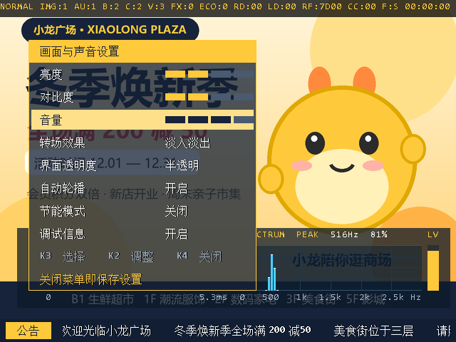
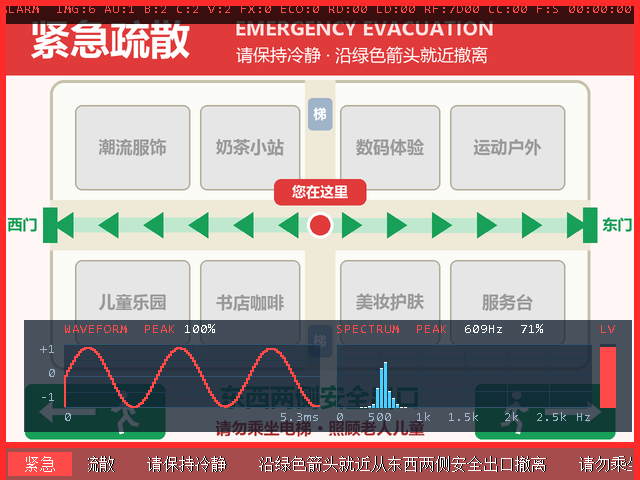
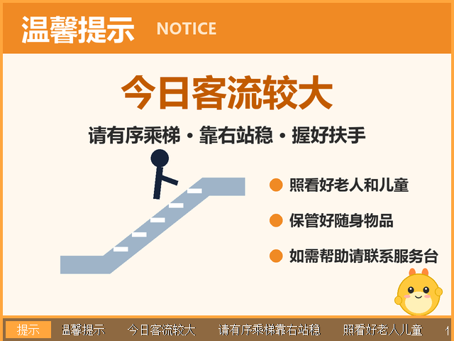
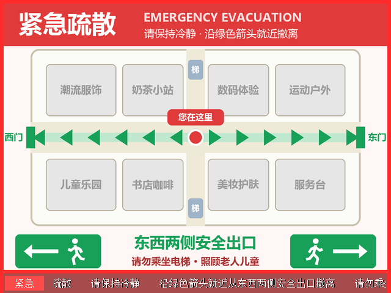
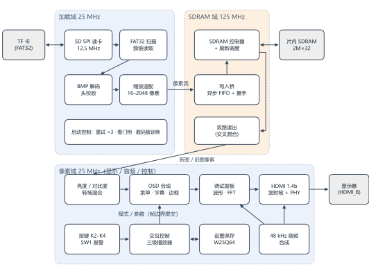

# 分级应急智显播控终端

基于安路 **EG4S20BG256**（HX4S20C 开发板）的离线 HDMI 信息发布终端。读卡、解码、缩放、帧缓存、HDMI 音视频、交互和可视化全部由 FPGA 逻辑实现，不使用任何处理器。

2026 全国大学生嵌入式芯片与系统设计竞赛 FPGA 创新设计赛道（安路 · 选题一）参赛作品。

<p align="center">
  
  
</p>
<p align="center">
  
  
</p>
<p align="center"><sub>以上画面由 ModelSim 运行 RTL 逐像素渲染得到，与实板显示一致</sub></p>

## 功能

- **TF 卡加载**：FAT32 根目录中的 `PIC1.BMP`～`PIC6.BMP`，24 位非压缩 BMP，宽高各 16～2048 像素、任意比例；加载时保持比例适配到 640×480（缩小用区域平均，放大用双线性），预存进片内 SDRAM，播放期间不再读卡
- **三级播控**：普通模式轮播 4 张；注意模式在广告间插播告示；拨码开关 SW1 模拟报警输入，拨上立即切到疏散图并响警报，拨下恢复
- **HDMI 输出**：640×480@60 Hz 视频 + 48 kHz 音频（FPGA 实时合成，随模式变化）
- **画面处理**：5 档亮度 / 对比度；淡入淡出、滑动揭示、直接切换、交叉混合 4 种转场；三档透明度 OSD 菜单、滚动字幕、告警边框
- **音频可视化**：波形 + 128 点 FFT 频谱（64 频段，0～2.95 kHz），带坐标与峰值读数
- **可靠性**：菜单参数断电保存在板载 W25Q64（双扇区日志、CRC、后台预擦除）；启动失败自动重试；数码管故障码；SDRAM 刷新调度（修复官方控制器从不刷新的问题）

## 系统结构

<p align="center"></p>

| 时钟域 | 频率 | 内容 |
|---|---|---|
| video_clk | 25 MHz | 读卡加载、显示合成、音频、按键与菜单、设置保存 |
| ext_mem_clk | 125 MHz | SDRAM 控制器、刷新调度、读写突发 |
| hdmi_5x_clk | 125 MHz | TMDS 串行化 |

跨时钟只发生在异步 FIFO（写入 1 处、读出 2 处）和少量电平 / 翻转同步处。详细设计见 [docs/设计与优化.md](docs/设计与优化.md)。

| 资源 | 用量 |
|---|---|
| LUT / 寄存器 | 15567 / 9574（79.4% / 48.9%） |
| BRAM9K / DSP / PLL | 50 / 1 / 2 |
| 时序 | 用户逻辑各时钟域建立、保持均为正裕量 |

## 目录

```text
rtl/                 Verilog 源码（顶层 emergency_display_top.v）
  storage/           SD 卡 SPI、FAT32、BMP 解码与缩放
  flash/             W25Q64 设置存储
constraints/         管脚（pin.adc）与时序约束（timing.sdc）
sim/                 ModelSim 测试平台与行为模型（SD 卡、SDRAM、W25Q64）
scripts/             TD 构建、仿真回归、素材生成、缩放参考模型
assets/              OSD 字库 / 菜单 / 字幕 ROM（.hex），sdcard/ 下为 6 张演示图
td_project/          TD 工程文件
docs/                设计说明、上板与验收手册
```

## 快速开始

### 1. 准备官方例程文件

工程复用了安路官方例程中的 SDRAM 控制器、HDMI 发射核、PLL、FIFO 等 IP 和少量模块，这些文件**不包含在本仓库**。从竞赛资料包中的官方例程 `lab_ex5_i2s` 复制：

| 从 | 到 |
|---|---|
| `lab_ex5_i2s/src/user_source/` | 本仓库 `user_source/` |
| `lab_ex5_i2s/src/td_project/al_ip/` | 本仓库 `td_project/al_ip/` |

### 2. 编译

需要安路 TD 6.2（开发使用 6.2.168116）。在命令行执行：

```powershell
<TD 安装目录>/bin/td_commands_prompt.exe scripts/build.tcl
```

位流和时序、资源报告输出到 `build/`。脚本中已包含字库 ROM 初值（`eram_init on`）和布线后保持时间修复（`fix_hold`），建议用脚本而不是 GUI 直接编译。

### 3. 下载与固化

开发板 `HDMI_B` 接显示器，TD `Download` 选 `build/Emergency_Display_Baseline.bit`：调试用 SRAM 模式；最终写入配置 Flash，上电自启。

### 4. 准备 TF 卡

FAT32 格式，把 `assets/sdcard/PIC1.BMP`～`PIC6.BMP` 复制到根目录。PIC1～4 为轮播图，PIC5 为注意告示，PIC6 为紧急疏散图；也可以换成自己的图片（规则与故障码见 [docs/上板与素材验收.md](docs/上板与素材验收.md)）。

### 操作

| 输入 | 菜单关闭 | 菜单打开 |
|---|---|---|
| K4 | 打开菜单 | 关闭菜单并保存 |
| K2 | 短按下一张，长按普通 ↔ 注意 | 当前项下一个值 |
| K3 | 开关调试画面 | 选下一项 |
| SW1 | 拨上紧急模式，拨下恢复 | 同左 |
| KEY1 | 复位并重新读卡 | 同左 |

## 仿真

22 个 ModelSim 测试平台覆盖读卡协议、FAT32、缩放（与 Python 参考模型逐像素比对）、跨时钟写入、双路读出、SDRAM 刷新、显示合成、按键、FFT、Flash 断电恢复等，每个自动判定 PASS。

```powershell
# 需要 Python 3（numpy、Pillow）和 ModelSim；ModelSim 路径可用环境变量 MODELSIM_BIN 指定
python scripts/run_sim.py                                  # 全部（约 1 小时，tb_assets 最慢）
python scripts/run_sim.py --work=sim/work_alt tb_controls  # 只跑指定用例
```

`tb_sdram_refresh` 用官方加密控制器 + 行为级 SDRAM 模型复现了官方配置“从不刷新”和“刷新打断突发导致 tRFC 违例”两个问题，并验证了本工程的刷新调度。

## 重新生成素材

`python scripts/prepare_assets.py` 重新绘制 6 张图片并生成 OSD 字库、菜单、字幕 ROM。需要微软雅黑、宋体、Consolas 字体（Windows 自带，其他系统用环境变量 `FONT_DIR` 指定字体目录）。图片中的“小龙广场”、吉祥物和平面图均为原创演示内容。

## 代码来源说明

- **官方 IP 与例程**：SDRAM 控制器（加密）、HDMI 1.4b 发射核（加密）、PLL、异步 FIFO、`frame_fifo_read`、视频时序等来自安路官方例程，未修改，需按上文自行获取。
- **课程参考代码**：`rtl/storage/` 中 SD 卡 SPI 与 FAT32 相关模块、`rtl/flash/` 中 W25Q64 读写模块参考第三方竞赛课程代码改写，文件头注明了来源，来源与原文件哈希记录在 `rtl/storage/reference_manifest.json`。
- 其余模块（缩放、写入桥、刷新调度、双路读出、显示合成、播放器、音频与 FFT、设置存储等）为本项目编写。
