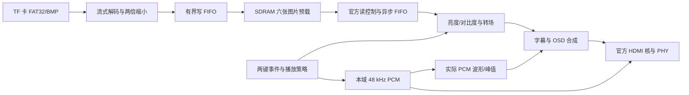

# 设计与优化：分级应急智显播控终端

本版本面向展馆入口、厂区通道等离线信息展示位置。平时轮播安全引导；板上按键模拟注意、区域 A 紧急、区域 B 紧急事件，输出对应背景、字幕、提示音及声音波形。路线为虚构演示场景。硬件自行完成 BMP 解码、缩放和播放，PC 仅制作素材和下载配置。

## 实现与资料依据

官方依据为 `lab_ex5_i2s/设计参考例程文档.md`、音视频例程、`pin.adc` 和系统/视频 PLL；课程依据为第三、五至十及十二至十四讲。官方 SDRAM 加密控制器、HDMI 核、PHY、PLL 参数保留；比赛应用层由本工程接管。`rtl/storage/reference_manifest.json` 保存课程来源和原文件哈希。存储协议参考实现经适配保留，BMP 解码器、目录扫描器、缓存写入、策略、交互、音频和视频合成按产品需求实现；课程原文件不改。

| 模块 | 与参考实现的接口差异与接法 | 验证 |
|---|---|---|
| FAT32 / SD SPI | 课程原本面向其他控制频率；本工程在 25 MHz 加载域运行（与像素时钟同源）。初始化 SPI 分频 32（390 kHz），读数据分频 1（12.5 MHz，MOSI 随 SCLK 下降沿变化，MISO 在下降沿后 40 ns 采样；`tb_spi` 带 22 ns 卡输出延迟和 MOSI 建立/保持检查）；高有效域复位适配为低有效模块复位 | SPI 卡模型的命令、寻址、CRC、空闲；目录跨簇和素材缺失 |
| BMP / 缩放 | 文件字节流转换为 RGB；支持输出原尺寸和两倍源尺寸。支持正、负高度及行填充。两倍源由两行缓冲做四像素平均，结果写入统一尺寸缓存 | 小图逐像素、上下方向及行填充；完整素材检查 |
| SDRAM 写入 | 官方异步 FIFO 把像素从 25 MHz 送到 125 MHz；125 MHz 侧生成地址、128 字连续突发与 12 拍间隔，按 BMP 方向逐行定位；启动期间不同时读写。每张图用 req/ack 翻转握手开始和结束，SDRAM 侧写完全部像素才应答，仅整帧写完才置完成位 | 写地址范围、重复地址、像素值、完成计数；`tb_loader_cdc` 真实频率比、满速推送、刷新/忙避让、卡死看门狗 |
| 视频读出 | 保留官方读状态机和异步 FIFO；增加应答同步、空读保护和欠载标记；四个缓存固定地址。VS 独立产生帧提交，读请求延迟两个像素时钟以先稳定图号；无卡时不因请求未应答而停止故障界面更新 | 无卡帧提交回归；真实官方 FIFO 两整帧读出；实板欠载观察 |
| 播放 / 转场 | 缓存预载，普通内容两张；紧急内容两张；帧边界提交。淡出到黑再淡入、向右揭示及直接切换 | 自动、手动、应急抢占与解除恢复 |
| 音频 | HDMI 直接接有符号 24 位双声道 PCM valid，代替 I2S 生成/解串及音频 PLL。原 HDMI ACR 模块保留 | 精确采样使能计数；实板听音及显示波形 |
| OSD / 参数 | 本域 ROM 字库、滚动中文、状态参数、菜单条、PCM 波形和峰值；亮度与对比度饱和处理 | 字库装载、正常直通、上下限、参数帧提交 |

## 吞吐与瓶颈

这里的执行效率以像素吞吐、加载占用和事件切换延迟衡量。视频处理流水线每拍可接收一个像素，参数与模式在消隐期提交；增加处理级数主要增加固定延迟，不降低稳定吞吐。

现有输出沿用 $25\,\mathrm{MHz}$、每帧 $800\times525$ 个时钟，帧率约 $59.52\,\mathrm{Hz}$。每像素占一个 32 位 SDRAM 字，四图预载约 $4.69\,\mathrm{MiB}$，连续显示的有效读取量约 $73.14\,\mathrm{MB/s}$。这只是数据量估算，不能代替控制器突发、刷新和时序验证。

## 现有瓶颈与措施

动态功耗的方向关系为：

$$P_{\mathrm{dynamic}}\approx\alpha C V^2f$$

本板不具备本工程可独立控制的 FPGA 电源域，因此通过降低翻转活动和减少无用逻辑改善功耗；不把资源节省比例换算成整板功耗节省比例。

| 瓶颈 | 措施及状态 | 预期收益 | 难度 | 取舍 |
|---|---|---|---|---|
| 每个 32 位字只用 24 位像素 | **后续方案，未实现**：四个 RGB888 像素打包成三个 SDRAM 字 | 保持颜色精度，缓存容量及显示读取数据量理论减少四分之一 | 高 | 增加跨字解包、行首对齐和 FIFO 适配；必须独立验证，不能声称整板省电四分之一 |
| 官方每次切图都要重新读 TF 卡 | 启动预载六张图（SDRAM 的上限 $\lfloor 2^{21}/307200\rfloor=6$），播放期间不再发卡请求 | 降低播放期 SPI/解码/写入翻转，切图无需等待读卡 | 中 | 启动等待，六帧缓存占用约 7.03 MiB；运行中改卡内容要复位重载 |
| OSD 覆盖遮挡图片 | 字幕条和菜单面板按“界面透明度”三档与图片混合（图片占 $1/8,3/8,1/2$），只用逐通道移位相加；文字加 1 像素阴影保证可读 | 多图层混合可调，无乘法器 | 低 | 高透明档在很亮的图片上文字对比度下降，靠阴影弥补 |
| 课程扇区缓冲被映射为 LUT 多路选择 | 同步读取、存储与复位控制分离，定向推断 BRAM | 减少大规模选择器和布线，空闲读端保持 | 中 | 付出 BRAM，需保持数据/valid 时序一致 |
| FAT32 簇地址有乘法及长组合链 | 合法的每簇扇区数转移位，减法/移位/加法分拍 | 降低算术面积和关键路径长度 | 中 | 每簇增加少数控制周期，对 SPI 吞吐影响很小 |
| 目录/文件头整块保存并多处组合读取 | 只提取必要字段，流式 BPB、目录和 BMP 头 | 减少无用寄存器及选择器 | 中 | 只支持明确列出的 FAT32/BMP 子集，拒绝不支持的格式 |
| 音频另占 PLL、I2S 时钟和跨域同步 | 在像素域用分数节拍产生 PCM，复用官方 ACR | 相比原基线少一个已用 PLL，减少持续高频翻转和一个 CDC | 中 | 有不超过一个像素周期的采样节拍抖动；需实板核对接收端声音 |
| 为低速交互各自设置宽高速计数器 | 两键共用毫秒使能，宽度由参数计算；稳定按键不运行消抖计数 | 缩小计数链，降低空闲翻转 | 低 | 共用节拍，时间精度为毫秒级 |
| 用通用浮点/除法做画质和缩放 | 五档亮度/对比度用移位加法与饱和；缩放在加载时完成，比例只在每张图开始时用 28 步串行除法算一次，像素级只有加法、查表倒数乘法和 8 位权重插值 | 低资源，无运行时通用除法，显示链路不变 | 中 | 加载时缩放，切图无额外延迟；参数为离散档 |
| 双图交叉混合增加 SDRAM 读取需求 | 第四种转场“交叉混合”：`ed_framebuffer` 内复制一套官方读状态机和异步 FIFO 读旧图，只在混合的约 32 帧里请求；两路由授权寄存器交替仲裁（一路突发及其后 10 拍内另一路不得开始），返回数据按 64 项标签 FIFO 分回各路；像素端 $(\text{新}\cdot m+\text{旧}\cdot(16-m))/16$ 用移位加法 | 混合帧读取量翻倍（约 37 M 字/秒，SDRAM 125 M），其余帧不变 | 高 | 多 2 块 BRAM 和一套读控制；`tb_framebuffer` 验证两路逐字正确、无重叠、无欠载 |
| 音频可视化的频谱代价 | 波形之外加 128 点基 2 FFT（`ed_audio_spectrum`）：48 kHz 先 8 点平均降到 6 kHz，Hann 窗，原位计算，一个 18×17 乘法器由加窗和蝶形分时共用；每次约 5000 个时钟，采样要 21 ms，所以串行足够。64 个频段 0–2.95 kHz，幅值用 $\max+\tfrac38\min$ 近似，免开方 | 真正的频谱，资源约一个 DSP、两块 RAM | 中 | 只显示到 2.95 kHz（覆盖本机全部音色）；ECO 下变换次数减半。`tb_spectrum` 用四个已知频率核对峰值频段和高度（理论 58.6 → 实测 59） |
| 字幕、示波在 ECO 模式无需全速更新 | 字幕更新率降至四分之一，采集抽取间隔加倍，波形缓存发布降至每四帧一次 | 降低这两处状态/写存储活动 | 低 | 显示动画变慢；HDMI 扫描、PCM 采样和 SDRAM 刷新保持运行 |
| 原始复位直接跨域释放 | 每域异步置位、三级同步释放，启动等待后执行存储初始化 | 改善启动可重复性和跨域一致性 | 低 | 保留官方 PLL 配置；无外露 lock 的 PLL 仍需实板反复启动确认 |

`ECO` 是局部活动控制，不会关闭 FPGA 电源，不会关 HDMI 时钟或随意停止 SDRAM 刷新。板上电源轨电压不在本工程控制范围。

## 图片缩放

模块：`rtl/storage/bmp24_decoder.v` 中的 `bmp24_decoder`（只做头校验和逐像素输出）与 `image_fit_scaler`（适配），加载域 $25\,\mathrm{MHz}$、低有效异步复位。参考模型 `scripts/scaler_model.py`；`sim/tb_assets.sv` 对 12 张图逐字比对：六张素材（含 800×600 缩小和 480×360 放大），加 $1920\times1080$、$800\times600$、$320\times240$（自上而下）、$100\times300$、$2048\times16$、$16\times16$（自上而下）。

**几何**：$s=\min(640/W,\,480/H)$，输出 $\mathrm{round}(Ws)\times\mathrm{round}(Hs)$ 居中，黑边为纯 0。

**缩小**（$W\ge640$ 或 $H\ge480$）：区域平均。列方向用 DDA，每读入一个源像素累加 fit_w，累计达到 $W$ 时结束一个输出列；行方向同理。每个输出像素取 $n_x\times n_y$ 个源像素的平均。除法换成查表倒数：

$$\bar v=\left\lfloor\frac{\Sigma\cdot R_n+2^{15}}{2^{16}}\right\rfloor,\quad R_n=\mathrm{round}(2^{16}/n)$$

列累加和存在 $640\times33$ 位 BRAM 中，源行流过即完成累加，不需要整帧缓存。

**放大**（$W<640$ 且 $H<480$）：双线性，端点对齐映射 $s_x=i(W-1)/(\mathrm{fit\_w}-1)$，16 位小数；权重取高 8 位，$v=a+\lfloor((b-a)f+128)/256\rfloor$。两行源行缓存，各 640 深。

**范围 $16\le W,H\le2048$ 的依据**：

| 约束 | 数值 |
|---|---|
| 缩小平均数 | $W\le2048$ 时 $n_x\le\lceil2048/640\rceil=4$；倒数表到 8，留余量 |
| 放大行缓存 | 放大时 $W<640$，640 深足够 |
| 吞吐 | 源像素进入 512 深 FIFO，余量不足时暂停取下一个扇区；输出每拍最多一个 |
| 计数位宽 | 宽高 12 位，像素数 23 位（$2048^2$） |
| 下限 | 16 以下放大后只剩色块；已含 $16\times16\to480\times480$ 的 30 倍用例 |
| 读卡时间 | 与文件大小成正比；$1920\times1080$ 约 6 MB |

**无乘法器实现**（2026-11-02）：全工程 DSP 用量 0/29（此前 3）。

| 位置 | 原做法 | 现做法 | 依据 |
|---|---|---|---|
| 缩放几何、平均、插值权重 | 并行乘法器，单周期完成 | 一个共享移位加法乘法器，三色顺序计算，乘数剩余位为 0 即提前结束 | 25 MHz 下源像素约每 96 个时钟才到一个，单像素 30–100 个时钟足够 |
| BMP 完整性校验 | `W×H`、`stride×H` 两个乘法 | 统计完整行数，声明大小不超过文件大小 | 只需判断行是否读满 |
| 视频淡入淡出 | `像素×gain` 三个乘法器 | `gain` 只有 5 位，按位移位相加 | 像素通路保持每拍一个像素 |
| 提示音包络 | `sine×env` 乘法器 | 每个采样开始的 16 步串行移位加法 | 每个 48 kHz 采样有 520 个时钟 |

结果：缩放加入后，125 MHz 存储域从单周期方案的 −6.98 ns 回到 +0.073 ns，0 违例；其余时钟域均为正裕量。数据通路寄存器只在对应步骤翻转，闲置时不动作。时序收敛的关键是按输入速率降速串行化；DSP 是现成的硬核资源，并非一律回避，后续在合适处可以直接使用。

**加载链降频**（2026-11-02）：此后加入设置保存、启动重试等功能后，125 MHz 存储域又落到 −0.24～−0.47 ns，且随布局变化，提高布局力度也不能稳定收敛。根本原因是加载链的工作量远低于 125 MHz：SPI 卡每 1.28 µs 才给一个字节。现在整条加载链（SD/FAT32/BMP/缩放、启动控制、数码管）改跑已有的 25 MHz 像素时钟，不新增时钟网络；只有 SDRAM 写口留在 125 MHz，由 `media_frame_loader` 内的官方异步 FIFO 跨域。

| 项目 | 改前（125 MHz） | 改后（25 MHz） |
|---|---|---|
| 加载逻辑每拍预算 | 8 ns | 40 ns |
| SD 读数据时钟 | 7.8 MHz，SCLK 下降后 64 ns 采样 | 构建 G：6.25 MHz（80 ns）；之后提到 12.5 MHz（40 ns），见下 |
| 跨时钟结构 | 启动结果、状态多处跨到像素域 | 仅 SDRAM 写口一处：异步 FIFO + 一对 req/ack 翻转握手；启动结果与像素域同时钟 |
| 125 MHz 域寄存器端点 / 最差裕量 | 9016 / +0.001 ns（构建 F） | 1615 / +1.213 ns（构建 G） |
| LUT / 寄存器 / BRAM9K / DSP | 13110 / 8355 / 44 / 0（构建 F） | 12745 / 8626 / 45 / 0（构建 G） |

**读卡提速**（2026-11-02，实板反馈启动偏慢）：素材改为六张、合计约 4.9 MB（原四张约 9.2 MB，其中两张为 1280×960）；读数据 SCLK 从 6.25 MHz 提到 12.5 MHz（`SPI_CLK_DIV 1`）。字节引擎改为 MOSI 随 SCLK 下降沿变化，否则分频 1 时 MOSI 会与上升沿同拍变化。MISO 在下降沿后 40 ns 采样，大于卡输出延迟（默认速度 ≤14 ns）加管脚延迟；若实板读卡异常，回退 `SPI_CLK_DIV 2`。

构建 G 中用户逻辑各时钟域建立、保持均为正裕量；仍为负的只有 `ext_mem_clk` 与 `ext_mem_clk_sft` 之间的硬 SDRAM 模型路径，与历史基线相同，见下文“工程验证边界”。

## 时钟域及跨域

| 信号组 | 来源 → 目的 | 方式 |
|---|---|---|
| 按键 | 外部 → 像素域 | 两级同步及毫秒消抖 |
| 启动成功、故障 | 加载域与像素域同为 25 MHz | 无跨域，帧边界采纳 |
| SDRAM 初始化完成 | 存储域 → 加载域 | 单调电平两级同步 |
| 启动完成（读出使能） | 加载域 → 存储域 | 单调电平两级同步 |
| 写入像素 | 加载域 → 存储域 | 官方异步 FIFO（Gray 指针，IP 约束），每字 {行序, RGB} |
| 写入开始/结束 | 加载域 ↔ 存储域 | req/ack 翻转各两级同步；图号、像素计数、结果位在翻转传递期间保持不变 |
| 写入和校验和清零、当前图号 | 加载域 → 存储域 | 启动脉冲转翻转后同步；图号只在一张图写完后变化，两级同步 |
| 读请求 | 像素域 → 存储域 | 官方保持请求、同步与应答协议；图号在请求期间稳定 |
| 读应答 | 存储域 → 像素域 | 两级同步 |
| 像素数据 | 存储域 → 像素域 | 官方异步 FIFO，保留 IP 的 Gray 指针约束 |
| 复位 | 板载时钟 → 各域 | 每域 `ed_reset` 异步置位、三级同步释放；同步器置位输入按设计为异步，SDC 中只对其设伪路径 |
| 模式、字幕、参数、音频、波形 | 像素域内部 | 帧提交或采样使能，无新增音频 CDC |
| SDRAM 相移时钟 | 原 PLL → SDRAM IP | 官方接口保留，不对相关时钟切断分析 |

## 优先深入的方向

1. **应急切换的确定性**：预载图、最高优先级帧提交、模式解除恢复、TF 异常显示兜底。接下来上板测输入至首个对应画面的延时，并统计反复触发的最大值。
2. **缩放质量**：已实现任意尺寸加载时适配，见下节。后续可做亮度伽马感知的平均与锐化。
3. **功耗证据**：固定同一素材、音量、屏幕亮度和供电位置，比较 ECO 开关、静态图片和轮播。用 USB 电流表或电源分析仪记录平均电压、电流和测试时长，避免把便携屏耗电混入 FPGA 优化结论。用仿真 VCD 翻转数作为局部活动证据，最终功耗以实测为准。

## 工程验证边界

ModelSim 的卡与存储用例验证协议和数字行为，不等同于真实卡和硬 SDRAM 电气时序。TD 需分别检查用户逻辑路径、FIFO 约束、硬 SDRAM 模型路径与 I/O 覆盖。历史基线同样存在的硬 SDRAM 负裕量仍保留在报告里，不以 false path 掩盖，不据此认定板卡故障。生成位流不代表时序、实板和固化完成；本次客观结果另见日期记录。

## 最终版结果（2026-11-02）

| 项目 | 数值 |
|---|---|
| LUT / 寄存器 | 15567 / 9574（79.4% / 48.9%） |
| BRAM9K / DSP / PLL | 50/64、1/29、2/4 |
| 最差建立裕量 | video_clk +16.712 ns，ext_mem_clk +0.823 ns |
| 最差保持裕量 | +0.022 ns（布线后 `fix_hold`） |
| 仍为负的路径 | 只有官方 SDRAM 硬核与相移时钟之间的模型路径，与官方例程相同 |

已固化到配置 Flash 并实板验证（`docs/2026-11-02-最终版实板验证.md`）。
